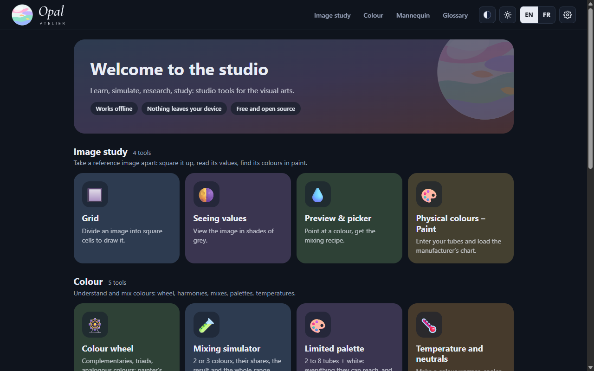
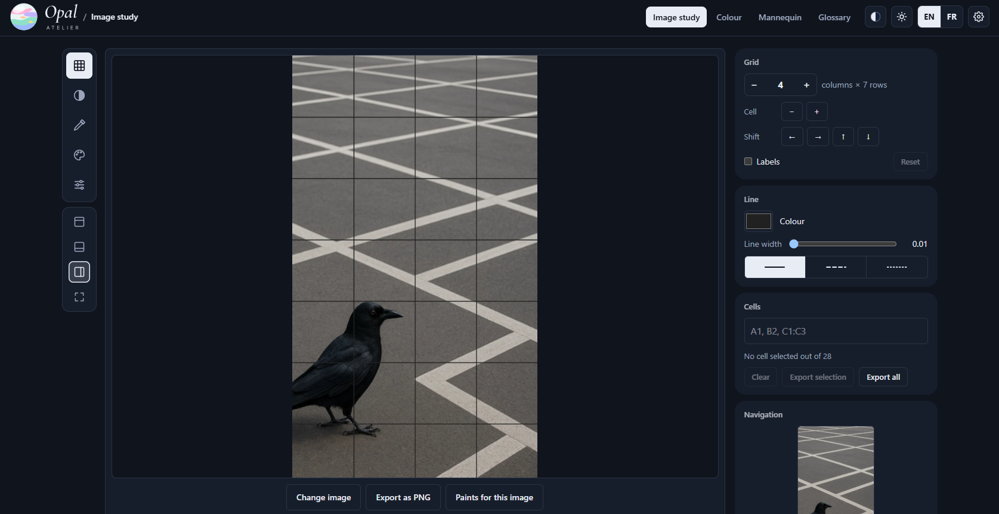
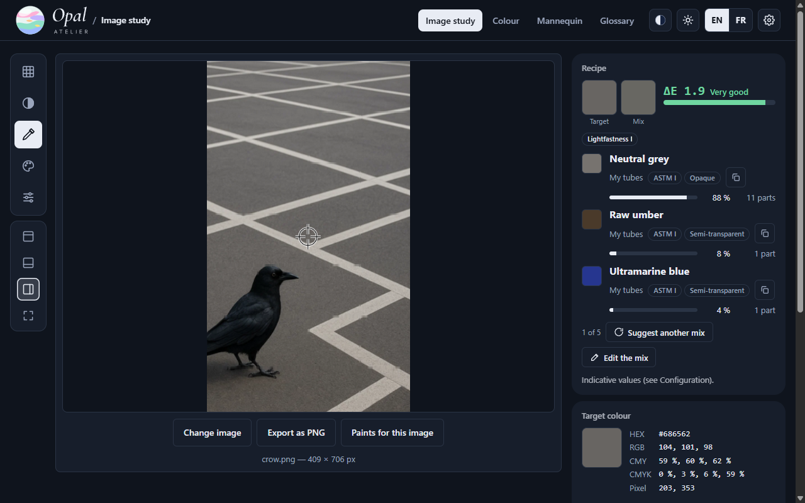
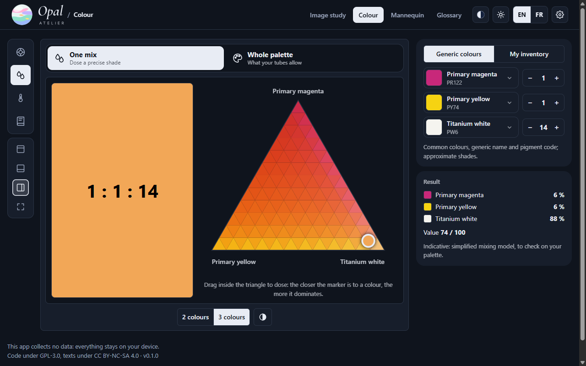
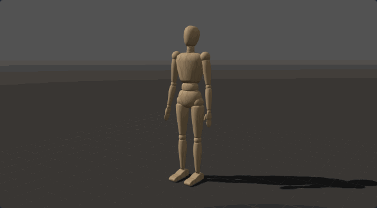
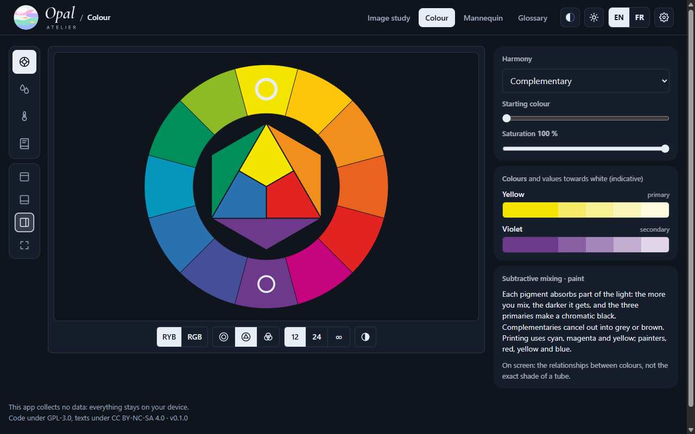
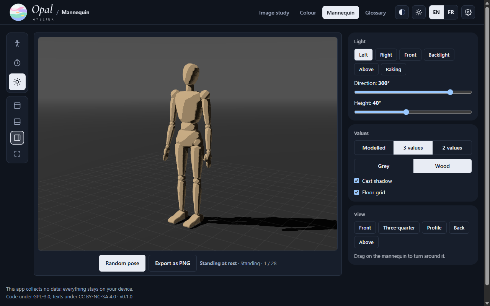
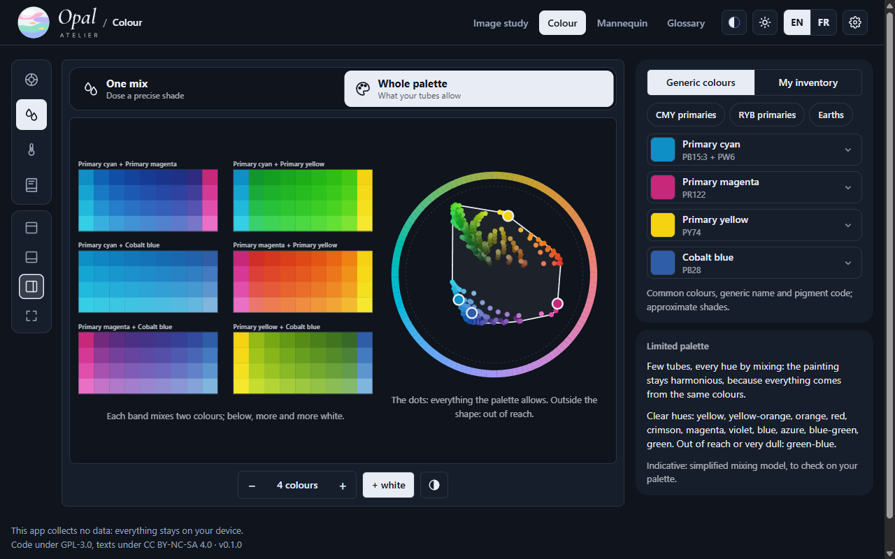

<h1 align="center">
  <picture>
    <source media="(prefers-color-scheme: dark)" srcset="build/logo-inverse.svg" />
    
  </picture>
</h1>

<p align="center">
  <a href="LICENSE"></a>
  <a href="LICENSE-CONTENT"></a>
  
  
  
  
  
</p>

<p align="center">
  <a href="https://bil150.github.io/opal-atelier/"><b>Open the app</b></a> ·
  <a href="https://github.com/bil150/opal-atelier/releases/latest"><b>Download for Windows, macOS, Linux</b></a>
</p>

Learn, simulate, research, study: studio tools for the visual arts — image study, colour mixing, a 3D
mannequin and a glossary. No account, no server, no tracking: everything stays on your device.

A free-time project. Forks are welcome, under the same GPL-3.0 license.

**Languages of the app**: English, Français (chosen in Settings).

No paint brand is shipped: you build your own swatch charts. See [Trademarks](#trademarks).

<p align="center">
  
  
</p>

### Can I mix this colour with my paints?

Point at any colour of a reference image: the picker gives the mix your own tubes can reach, its closeness
(ΔE) and the proportions, in percent and in parts. The mixing simulator doses two or three paints by hand.

<p align="center">
  
  
</p>

### A wooden mannequin in 3D

28 poses to draw from every angle, a timed sketch, and an adjustable light to study values in 2 or 3 tones.

<p align="center">
  
</p>

<p align="center">
  
  
</p>

### Everything a palette can reach

Choose a few tubes: the whole range they can mix appears, every pair lightened with white, and the wheel shows
which hues are within reach and which escape the palette.

<p align="center">
  
</p>

## Targets

One React codebase, three ways to use it:

| Target         | How                                                          |
| -------------- | ------------------------------------------------------------ |
| Web            | GitHub Pages                                                 |
| Phone / tablet | Installable PWA (works offline)                              |
| Desktop        | Electron app — Windows (NSIS), macOS (DMG), Linux (AppImage) |

Interface available in **English** and **French**.

## Stack

React 19 · TypeScript (strict) · Vite · Tailwind CSS 4 · React Router (hash routing) · i18next ·
vite-plugin-pwa · Electron + electron-vite + electron-builder · Vitest + Testing Library · ESLint + Prettier

## Getting started - Dev

Requires Node.js 22 or later.

```sh
npm install
npm run dev        # desktop app with hot reload
npm run dev:web    # same app in the browser
```

## Scripts

| Script                    | Purpose                                                    |
| ------------------------- | ---------------------------------------------------------- |
| `dev` / `dev:web`         | Run in Electron / in the browser                           |
| `build`                   | Type-check, then build the desktop app into `out/`         |
| `build:web`               | Type-check, then build the website + PWA into `dist-web/`  |
| `start`                   | Run the built desktop app                                  |
| `preview:web`             | Serve the built website locally                            |
| `dist` / `dist:dir`       | Package installers into `release/` (or an unpacked folder) |
| `typecheck`               | TypeScript project references (`tsc -b`)                   |
| `lint` / `lint:fix`       | ESLint (typescript-eslint strict, type-checked)            |
| `format` / `format:check` | Prettier                                                   |
| `test` / `test:watch`     | Vitest                                                     |
| `check`                   | The checks CI runs first: typecheck, lint, format, tests   |
| `icons`                   | Regenerate every icon from `build/icon.svg`                |

## Project layout

```
src/
  main/        Electron main process (window, external links)
  preload/     Minimal bridge exposed as window.opal (+ its typed contract, opal-api.ts)
  renderer/    The app itself — shared by web, PWA and desktop
    public/    Static files (icons)
    src/
      components/   Reusable UI (layout, studio frame, buttons, dialogs…)
      features/     One folder per tool: glossary, image-study, color, mannequin, paints (shared tubes)
      hooks/        Shared React hooks (storage, environment)
      i18n/         i18next setup and locales (en, fr)
      lib/          Framework-free engines: paint mixing, colour theory, swatch charts, zip, pixels
      pages/        Home page
      platform/     Web / Electron differences (saving files, clipboard, install prompt)
tests/
  setup.ts     Vitest setup (jsdom)
  helpers/     Shared test helpers (render the app, fake window, fake 2D canvas)
  fixtures/    Frozen outputs of the original site, used by characterisation tests
build/         Packaging resources (icons, logos)
docs/          Screenshots of this README
scripts/       Tooling (icon generation, test runner)
.github/       CI (check and build), CD (publish by hand), Dependabot
CONTRIBUTING.md  How to report a problem and propose a change
```

## Tests

Tests sit next to the code they cover (`*.test.ts` / `*.test.tsx`). The engines carried over from the
original prototype are checked against `tests/fixtures/*.json`: outputs recorded from the original code, kept
frozen so any change of behaviour shows up. UI tests render the whole app at a given address
(`tests/helpers/render-app.tsx`). WebGL and the 2D canvas don't exist in jsdom: the 3D scene is replaced
by a stand-in and the canvas by `tests/helpers/fake-canvas.ts`.

## Publishing

Build once, deploy many: CI checks and builds every change; CD, started by hand, publishes those very files.
Nothing is rebuilt between the test and the publication.

### CI — `.github/workflows/ci.yml` (automatic)

- **When:** every pull request to `main`, and every push to `main` (a merged pull request).
- **Check:** `npm ci`, then `npm run check` (types, lint, formatting, tests). If it fails, nothing is built.
- **Build:** the website + PWA (artifact `website`) and the Windows, macOS and Linux installers (artifacts
  `installer-<system>`), each system on its own machine.
- **Stored:** as artifacts of the run (Actions → the run → _Artifacts_), kept 90 days. Nothing is published.

### CD — `.github/workflows/cd.yml` (by hand)

- **When:** Actions → **CD** → **Run workflow**, on `main`, with two options (both ticked by default): publish
  the website, create the release.
- **Find the build:** the CI run of the latest commit of `main` must have succeeded (CD waits if it is still
  running); the version is read from `package.json` and must not have a release yet.
- **Website:** that run's `website` artifact is published on GitHub Pages.
- **Release:** a **draft** release `<version>` is created with that run's installers and notes generated from
  the merged pull requests; its tag is created when the draft is published.

### Releasing a version

1. Set `version` in `package.json` (e.g. `0.2.0`: three numbers, no `v`), in a pull request, and merge it.
2. Wait for CI to be green on `main`.
3. Run **CD**.
4. In **Releases**, review the draft (three installers, notes), then **Publish release**.

The website alone can be republished any time by running CD with only _Publish the website_ ticked.

GitHub Pages must use **GitHub Actions** as its source (Settings → Pages). Installers are not code-signed: Windows
and macOS warn on first launch.

## Conventions

- Types live next to the code that owns them — no global `types` file.
  Object shapes are `interface`s; fixed sets of values are string `enum`s (never `const enum`).
- Files are `kebab-case`, React components `PascalCase.tsx`.
- User-facing text goes through i18next; English and French must have the same keys (enforced by a test).
- No brand names anywhere, and no preset paint data: users build their own swatch charts.
- Paths stay relative (`base: './'`, hash routing) so one build runs under the Pages sub-folder and from `file://` in Electron.

## Contributing

Issues and pull requests are welcome: see [CONTRIBUTING.md](CONTRIBUTING.md). In short, run `npm run check`
before opening a pull request, keep English and French in step, and never add brand data.

## Trademarks

Opal Atelier contains **no brand**: no paint brand, product name or manufacturer chart is shipped with the
app, its examples or its tests. Paints are described by generic names and Colour Index codes (PB29, PY43…).

Users may enter their own products, with their names and possibly their brands, in a **private setting**: to
describe the paints they own. These entries are written by the user, stay in their browser's storage on their
device and are never sent anywhere. Any brand or product name cited by a user belongs to its owner. Opal
Atelier has no affiliation with, and no endorsement from, any manufacturer, and makes no claim about any
product.

Colours on screen and computed mixes are indicative: they depend on the screen, the light and the model used,
and never replace a test on the real paint.

## License

- **Code** — [GNU GPL v3.0 or later](LICENSE)
- **Texts and data** (glossary definitions, colour theory notes, poses) — [CC BY-NC-SA 4.0](LICENSE-CONTENT)

© bil150
